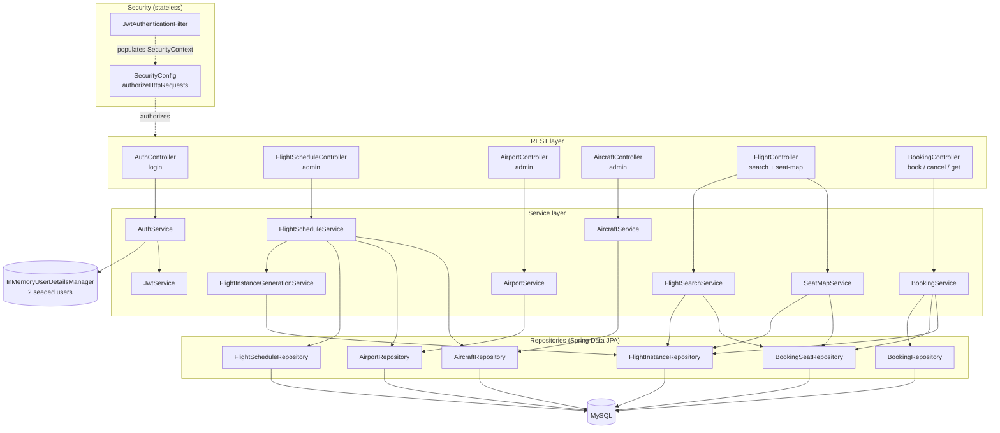
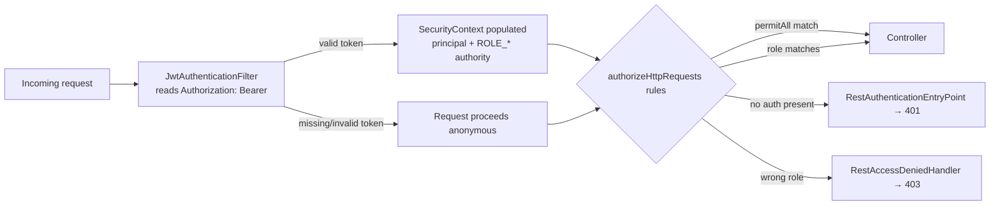
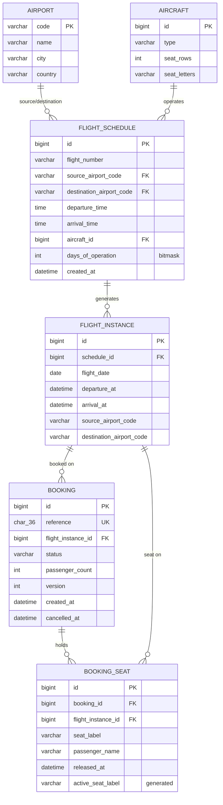
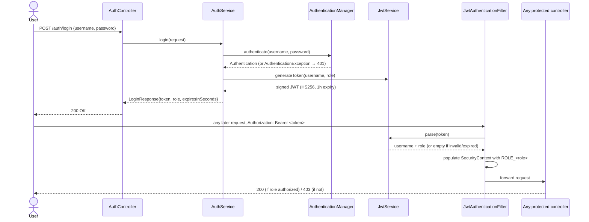
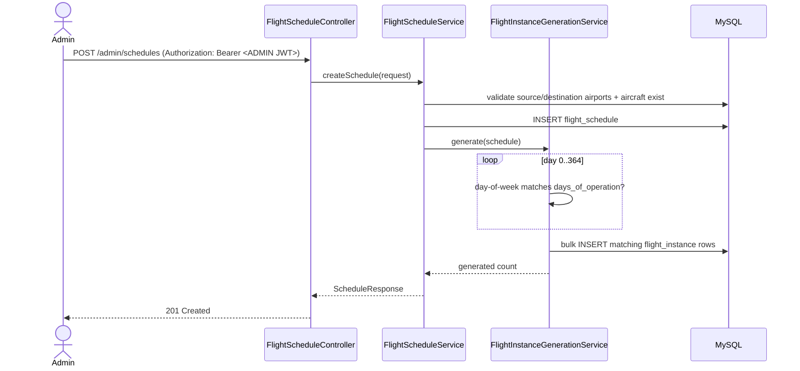
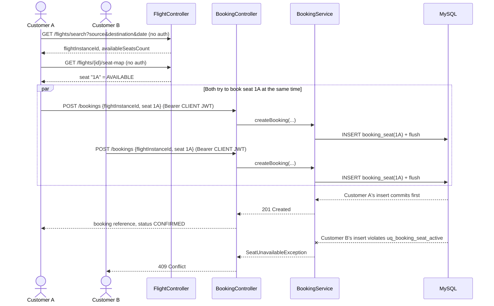
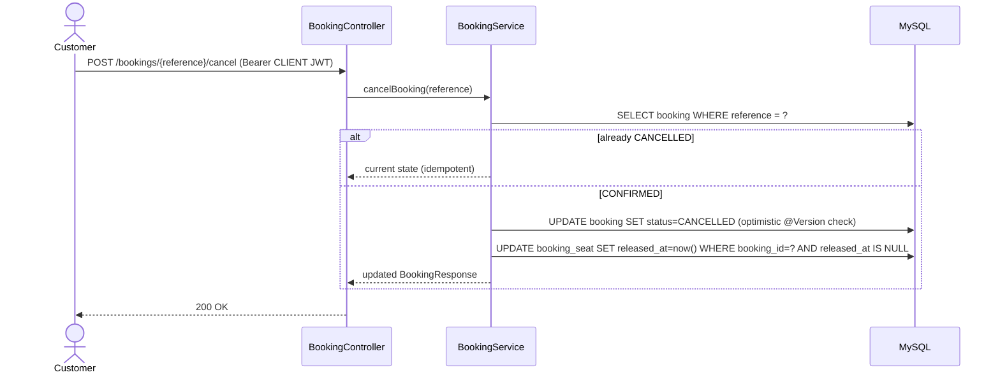

# High-Level Design

## Overview

A single Spring Boot service fronting MySQL. Package-by-feature layering
(`controller → service → repository`), no separate microservices — the assignment's scope
(single airline, one DB, modest data volumes) doesn't justify the operational cost of splitting
it further; everything here is a Spring `@Service` + Spring Data repository behind a REST
controller. A stateless JWT security layer sits in front of all of it: one login endpoint issues
tokens, a servlet filter validates them on every other request, and role-based access rules decide
what each token may reach — no server-side session state, no per-request database lookup for auth.

## Components

`GlobalExceptionHandler` (`@RestControllerAdvice`) sits across all controllers, translating domain
exceptions and constraint/optimistic-lock failures into HTTP status codes (see `lld/design.md`).
`RestAuthenticationEntryPoint`/`RestAccessDeniedHandler` do the equivalent job for the two auth
failure modes (401/403), which occur in the security filter chain *before* a request ever reaches
a controller, so `GlobalExceptionHandler` can't intercept them directly.

## Security architecture: where the JWT filter sits

`JwtAuthenticationFilter` is deliberately permissive by itself — an absent or malformed token never
throws there; it just leaves the request unauthenticated and lets `authorizeHttpRequests` decide
whether that matters for the path being hit. This keeps the filter simple and keeps *all*
authorization decisions in one place (`SecurityConfig`), rather than split across a filter and a
config class.

## ER Diagram

No schema changes for auth — the two users are in-memory (`SecurityConfig`), not a database table.

## Request flow: login → authenticated request

## Request flow: schedule creation (admin)

## Request flow: search → seat map → booking (including the concurrent-conflict path)

## Request flow: cancellation

## Major design decisions, assumptions, and the concurrency/flight-generation strategy

Documented in full in `README.md` (Design decisions section) rather than duplicated here.

## Known limitations (carried over from the latest review)

- **Auth is coarse-grained by design**: two fixed roles, no per-customer booking ownership — any
  CLIENT-authenticated caller can read/cancel *any* booking by reference, not just their own. A
  `booked_by` column plus an ownership check at the service layer is the natural next step, out of
  scope for this assignment.
- **No refresh tokens or revocation**: a leaked JWT stays valid until its 1-hour expiry; there's no
  server-side session to invalidate early. Acceptable for a demo/assignment scope with two static
  accounts; not something to carry into a real multi-tenant system unchanged.
- **Flight number is not unique**: `flight_schedule.flight_number` is indexed but not constrained
  unique, so two schedules can share a flight number. Not addressed — the assignment never
  specifies uniqueness, and real airlines do occasionally reuse numbers across routes/days, so this
  was left as a modeling choice rather than "fixed."
